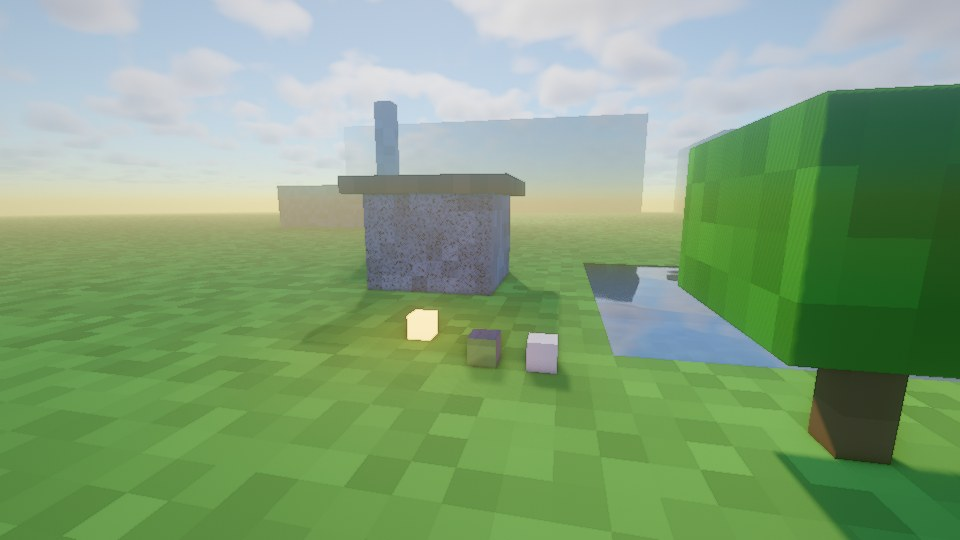
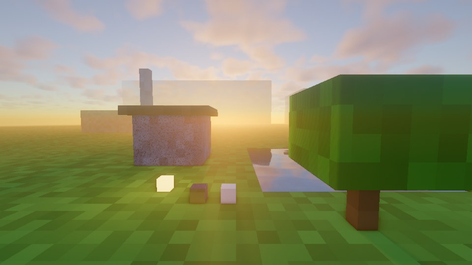
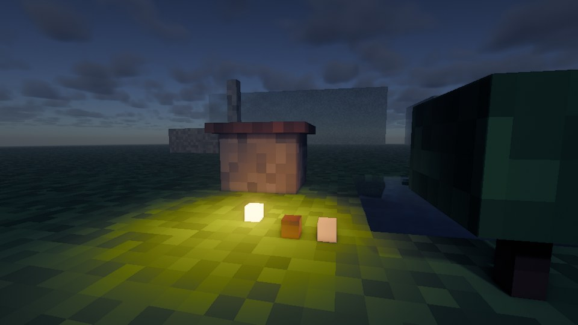
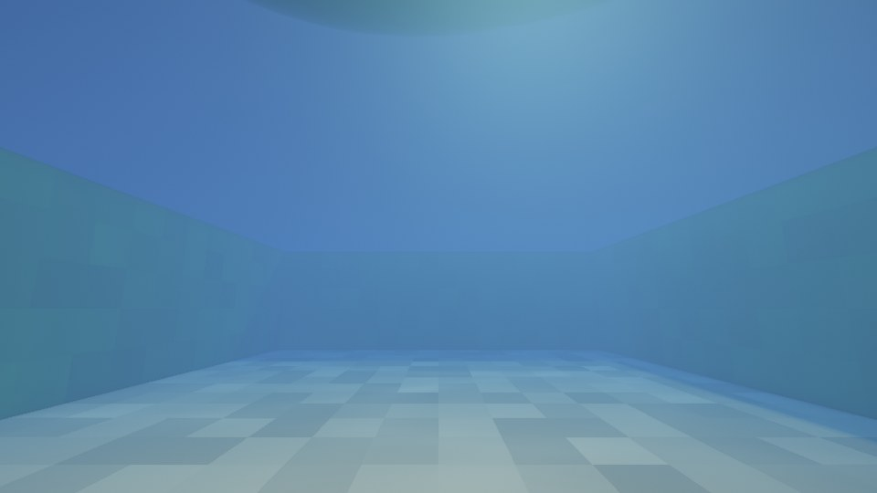

# Solstice Shaders

A complete deferred-rendering shader pack for Minecraft Java Edition (OptiFine and Iris), written from scratch.

| | |
|---|---|
|  |  |
|  |  |

These images come from `tools/preview/preview.py`, which runs the pack's real deferred, composite and final passes over a simple box test scene on a headless GPU. They are not in-game screenshots. In game you get real textures and terrain.

## Features

**Lighting**
- Deferred PBR shading (GGX specular, Schlick Fresnel, metals)
- Soft shadows that get softer further from the caster (PCSS blocker search plus Vogel-disk PCF), with a distorted shadow map for detail near the player
- Coloured shadows through stained glass
- Subsurface scattering in leaves and plants, driven by real light thickness from the shadow map
- Screen space ambient occlusion, vanilla AO kept separately (`separateAo`)
- Warm block light, handheld dynamic light, emissive torches, lava, glowstone and other light sources
- Shadows cast by the volumetric clouds

**Sky and atmosphere**
- Physically based sky (Rayleigh, Mie and ozone single scattering, plus a multiple-scattering approximation)
- Sun and moon light colours derived from the same atmosphere, so sunsets tint the whole world
- Ray marched volumetric cumulus clouds with multiple-scattering lighting, wind and weather-dependent coverage
- Vanilla moon phases and stars, with atmospheric extinction near the horizon
- Height fog, border fog that blends terrain into the sky at the render distance, and rain/overcast weather
- Volumetric light (god rays), above and below water

**Water**
- Procedural wind waves (sharp-crested, domain warped)
- Refraction, depth-based absorption and scattering, biome tint
- Caustics computed from the wave surface's curvature, seen from above and below
- Screen space reflections with a sky and cloud fallback, sun glint, total internal reflection and Snell's window underwater

**Materials**
- Built-in materials: metals, polished stone, ice, foliage, emissive blocks (see `block.properties`)
- Optional labPBR resource pack support (normal maps, AO, smoothness, F0/metals, emission, SSS)
- Rain makes exposed surfaces wet and forms reflective puddles
- Waving grass, flowers, crops, tall plants, vines and leaves. Shadows wave with them.

**Post processing**
- Temporal anti-aliasing (Halton jitter, Catmull-Rom history, variance clipping in YCoCg)
- Contrast-adaptive sharpening
- Six-level gaussian bloom
- Auto exposure with partial adaptation, so nights and caves still feel dark, plus scotopic (night vision) colour shift
- AgX, ACES or Hable tonemapping, with saturation, contrast and vignette controls

**Dimensions**: separate Overworld, Nether (no shadow pass, dense coloured fog) and End (custom sky with stars) paths.

## Installing

1. Install [Iris](https://irisshaders.dev) (Fabric/Quilt/NeoForge) or [OptiFine](https://optifine.net), for Minecraft 1.17 or newer.
2. Build the zip: `python3 minecraft-shaders/tools/package.py`. This writes `minecraft-shaders/dist/Solstice.zip`. You can also copy the `Solstice` folder itself.
3. Put `Solstice.zip` (or the `Solstice` folder) into `.minecraft/shaderpacks/`.
4. In game: Options → Video Settings → Shader Packs → Solstice.

Requires OpenGL 3.3 with the compatibility profile. That covers Windows and Linux with any GPU from the last decade. macOS is not supported.

### Profiles

Pick one at the top of the shader options screen:

| Profile | Shadow map | Shadow distance | Notes |
|---|---|---|---|
| Low | 1024 | 96 | no SSAO, no god rays, cheap clouds, for integrated graphics |
| Medium | 2048 | 128 | balanced |
| High (default) | 2048 | 160 | the intended look |
| Ultra | 4096 | 256 | high sample counts everywhere |

The biggest single performance options are **Shadow Resolution**, **Cloud Quality** and **Volumetric Light Quality**.

## Layout

```
Solstice/shaders/
  shaders.properties      menus, profiles, blending, loader flags
  block.properties        block ids (plants, leaves, water, glass, lights, metals, ...)
  lang/en_US.lang         option names and tooltips
  tex/noise.png           noise texture (generated by tools/make_noise.py)
  lib/                    shared code: settings, atmosphere, clouds, shadows, lighting, water, SSR, ...
  program/                the actual programs
  *.vsh / *.fsh           entry points (Overworld); world-1/ = Nether, world1/ = End
```

The entry files are generated by `tools/generate_wrappers.py`. Each one only sets `#version`, the dimension and a program macro, then includes the shared source in `program/`. Edit `program/` and `lib/`, not the generated files.

### Render pipeline

| Pass | What it does |
|---|---|
| `shadow` | distorted shadow map + coloured translucent shadows, waving geometry |
| `gbuffers_*` | G-buffer: albedo, normals (octahedral), lightmap, material, AO |
| `gbuffers_water` | water normals and tint; forward-lit glass/ice into a translucent buffer |
| `deferred` | sky lookup tables in colortex7: equirectangular sky, low-resolution clouds, ambient and light colours |
| `deferred1` | opaque lighting, SSAO, sky, sun, moon, stars, full resolution clouds |
| `composite` | water (refraction, absorption, caustics, reflections), glass, SSR, fog, volumetric light |
| `composite1` | TAA + auto exposure |
| `composite2/3` | bloom (downsample + separable blur into tiles) |
| `final` | sharpening, bloom, exposure, tonemapping, grading, dithering |

## Development tools

All tools live in `minecraft-shaders/tools/`:

- `validate.py [--variants]`: compiles every program in every dimension with `glslangValidator`, with includes and loader macros resolved the way OptiFine/Iris do it. `--variants` also compiles with labPBR on and most features off, to check code behind `#ifdef`s.
- `preview/preview.py OUT_DIR [preset...] [--world=nether|end] [--set=NAME=VALUE]`: offline preview through the real pipeline. Needs `moderngl`, Pillow and an EGL driver (Mesa works). Presets: `day sunset night water rain underwater`.
- `generate_wrappers.py`, `make_noise.py`, `package.py`.
